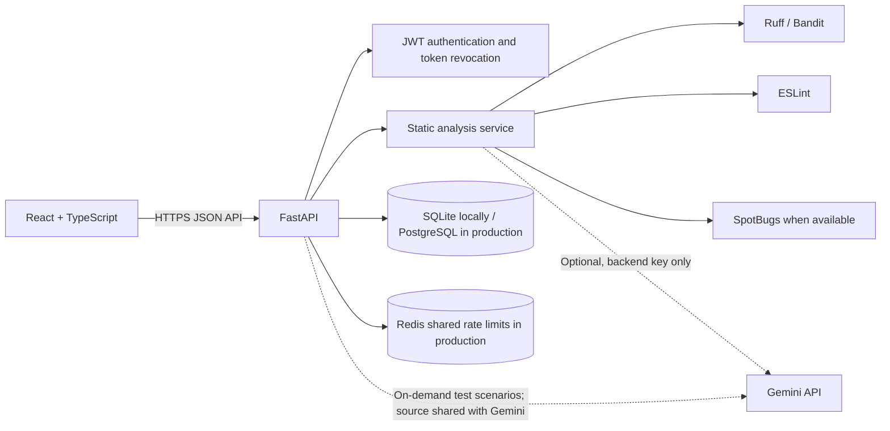

# Architecture

The backend validates source size and language before analyzing source using static tools. It does not import, compile, or execute user submissions. The analysis record and findings are stored with an owner relationship. Full source and static/AI evidence snippets are retained only with explicit request/server opt-in; without it, they are returned only in the immediate review response and omitted from persisted history. A request may opt into AI review when Gemini is configured; provider output is validated before it can be persisted or returned.

Rate-limit counters use in-memory storage for local development and Redis/Rediss storage for production. Production refuses the in-memory URI, and Redis failures are surfaced rather than silently switching each application process to independent counters.

Access tokens carry a unique token identifier. Logout records that identifier with its expiration in the database; protected routes reject revoked identifiers, and expired revocation records are cleaned up during later logout requests. Refresh-token rotation is not implemented.

Static analyzer findings and AI-generated hypotheses must remain separately labeled. Missing tools and provider errors are represented as explicit unavailable/error states rather than fabricated successful results.

On-demand test-scenario generation requires authentication and is limited to 10 requests per hour per client IP. It requires source to be available in the active review, sends that source to Gemini, validates 1–20 structured scenario descriptions, and neither executes nor persists the result. It does not generate test code.

## Quality score

When at least one static analyzer completes, the initial score is `max(0, 100 - 5 × number of static analyzer findings)`. It does not include Gemini hypotheses and is not severity-weighted or a security certification. When no static analyzer is available, no score is shown. The score is a simple review triage aid and should be interpreted alongside the findings and analyzer availability.

## Static analyzers

- Python: Ruff and Bandit run against a temporary source file with a fixed executable and 15-second timeout.
- JavaScript/TypeScript: ESLint uses a temporary flat configuration and the installed `@typescript-eslint/parser`; it runs syntax/static rules only.
- Java: Checkstyle runs only when `CHECKSTYLE_JAR` and Java are configured. It parses the source text; submitted code is not compiled or executed.
