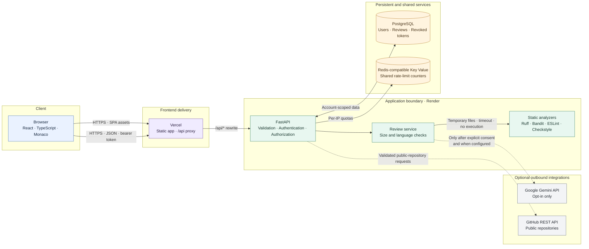

# Architecture and Security

## System overview

The browser sends source to the CodeLens API for static review. The API validates the request, checks authorization and limits, and dispatches the source to language-specific static analyzers. User code is treated as untrusted data throughout: the service does not import, compile, or execute submissions.

## Request and trust boundaries

1. **Browser to API:** Requests use HTTPS and JSON. Protected routes require a signed bearer token. Source is untrusted input even when the user is authenticated.
2. **API validation:** The API checks authentication, ownership, language, non-empty source, and the configured maximum request size before processing.
3. **Static analysis:** The backend invokes fixed analyzer executables with argument lists, temporary files, `shell=False`, and a 15-second timeout. Submitted code is not executed.
4. **Optional AI review:** Source is sent to Gemini only when the user opts in and the backend has a Gemini key. AI findings remain separate from static findings and are treated as unverified hypotheses.
5. **GitHub browsing:** Repository browsing is limited to public GitHub repositories and validated paths; repository contents are fetched as data, not cloned or run.
6. **Persistence:** Reviews are associated with their owner. Source and finding evidence are retained only when explicitly selected by the user or enabled by the server default; otherwise they are omitted or redacted in saved history.
7. **Rate limits:** Local development uses in-memory counters. The deployed service uses shared Redis-compatible storage; storage errors are surfaced rather than silently falling back to per-process counters.

## Authentication and data controls

- Passwords are stored as Argon2 hashes; plaintext passwords are not persisted.
- Signed access tokens carry a unique token ID. Logout stores the revoked token ID and expiry; protected endpoints reject revoked tokens.
- Users can access and delete only their own review history.
- Source and finding evidence are returned for the immediate review, but are omitted from persisted history unless retention is selected.
- AI-generated test scenarios are schema-validated descriptions. They are neither executable tests nor persisted records.
- Refresh-token rotation is not implemented.

## Analysis behavior

| Language | Analyzer | Execution boundary |
|---|---|---|
| Python | Ruff and Bandit | Static checks on a temporary source file |
| JavaScript / TypeScript | ESLint | Static checks using a temporary configuration |
| Java | Checkstyle, when Java and `CHECKSTYLE_JAR` are configured | Source parsing only; no compilation or execution |

Unavailable analyzers and provider errors are reported explicitly; the API does not fabricate successful results. The quality score is a simple static-finding triage aid, excludes AI hypotheses, and is not a security certification.

## Deployment topology and limitations

- **Frontend:** Vercel serves the static application and rewrites `/api/*` requests to the Render API.
- **API and database:** Render hosts FastAPI and PostgreSQL; Alembic migrations run when the container starts.
- **Rate limiting:** A Render Redis-compatible Key Value service shares counters across API instances.
- **Current plan:** These Render resources are on the Free plan. The API may sleep after inactivity, free Key Value data is not persistent across restarts, and free PostgreSQL expires after 30 days. This is demo infrastructure, not reliable production hosting.
- **Gemini:** No production `GEMINI_API_KEY` is currently configured. Gemini-powered features remain unavailable until one is added securely to the backend environment.

For table definitions, indexes, and relationships, see the [entity-relationship diagram](./ERD.md).
