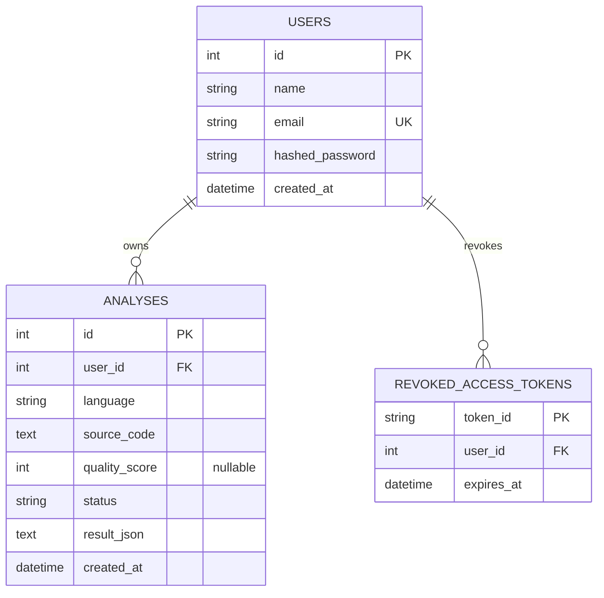

# CodeLens AI Entity-Relationship Diagram

The diagram reflects the SQLAlchemy models and Alembic migrations.

## Relationships and indexes

- Deleting a user cascades to that user's analyses and revoked-token records.
- `users.email` has a unique index.
- `analyses` has a composite index on `(user_id, created_at)` for account-scoped history.
- `revoked_access_tokens` has an index on `expires_at` for expired-token cleanup.
- Analysis findings and analyzer results are serialized in `analyses.result_json`; they are not separate relational tables.
- Access tokens are signed JWTs. Only revoked tokens are persisted, keyed by their token ID.
