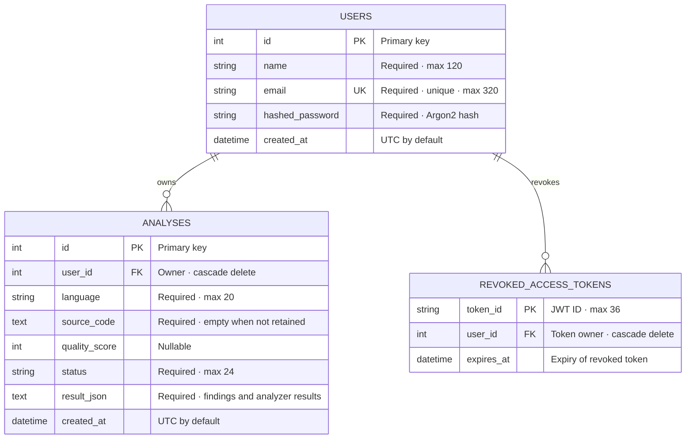

# Entity-Relationship Diagram

This diagram documents the persisted SQLAlchemy entities. Findings and analyzer statuses are stored as serialized JSON inside each review; they are not independent relational tables.

## Entity reference

| Entity | Purpose | Important fields |
|---|---|---|
| `users` | Account identity and password verification | `email` is unique; `hashed_password` stores a hash, never a plaintext password. |
| `analyses` | Account-scoped code-review history | `user_id` identifies the owner. `result_json` contains static findings, optional AI findings, and analyzer statuses. |
| `revoked_access_tokens` | Server-side invalidation for logged-out access tokens | `token_id` is the primary key; `expires_at` supports removal after the token can no longer be valid. |

## Keys, indexes, and retention

- **Ownership:** Each analysis and revoked-token row belongs to one user. Deleting a user cascades to both related collections.
- **Unique identity:** `users.email` has a unique index.
- **Review history:** `analyses` has a composite index on `(user_id, created_at)` for account-scoped history queries.
- **Revocation cleanup:** `revoked_access_tokens` is indexed by `expires_at` for expired-token cleanup.
- **Source retention:** `analyses.source_code` is set to an empty string when source retention is not selected. Finding evidence is redacted from saved results in that case; users may still see the immediate review response.
- **Serialized results:** Findings and analyzer statuses are JSON-serialized into `analyses.result_json`; generated AI test scenarios are not persisted.
- **Token storage:** Signed JWTs are not stored as session records. Only revoked JWT identifiers and their owner/expiry are stored.

The model source is [`backend/app/models.py`](../backend/app/models.py); request-time retention and access behavior is described in the [architecture and security overview](./ARCHITECTURE.md).
